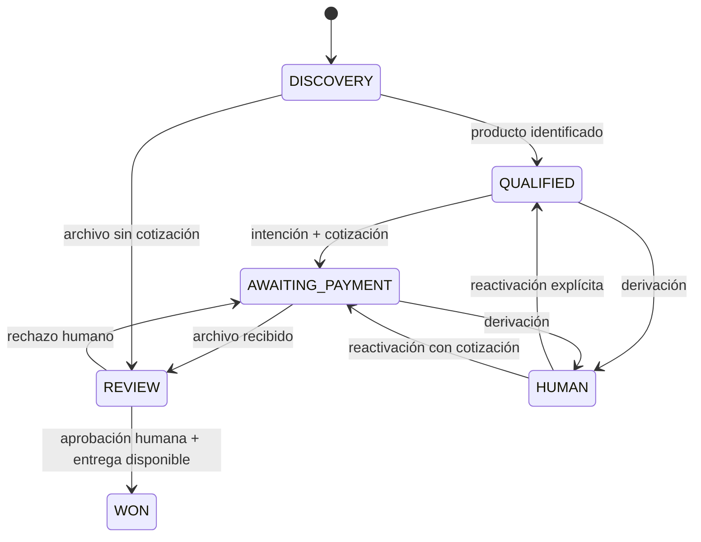

# Arquitectura y contratos

## Flujo transaccional

`IncomingMessage → SalesService.receive → mensajes + estado + pago/notificación + outbox → commit → dispatch → adaptador`.

Cada operación del motor toma un bloqueo de fila sobre el Workspace mediante un `UPDATE` dentro de una transacción Prisma. PostgreSQL serializa entradas, revisiones de pago, acciones humanas y despachos de ese negocio, incluso entre procesos. Los otros negocios usan otras filas. La demo PGlite tiene una conexión y no valida el comportamiento de locks entre procesos; el workflow PostgreSQL sí está preparado para ejecutar los mismos escenarios con pooling.

Un identificador de entrada se deriva con SHA-256 de workspace + conexión + ID externo. La restricción única de Message persiste entre reinicios. Las respuestas y la transición de estado se guardan en la misma transacción que la entrada. El reenvío del mismo evento retorna la conversación sin generar otra respuesta.

Los mensajes de salida tienen `PENDING`, `SENT` o `NEEDS_REVIEW`. El dispatcher toma el mismo bloqueo y usa el ID persistido como clave de idempotencia del proveedor. Mock es determinista. OpenWA documenta 24 horas de deduplicación; no se despachan automáticamente salidas con más de 23 horas. Los fallos ambiguos requieren revisar el gateway; no se reenvían a ciegas. No se afirma entrega exactamente una vez en una red externa. Un crash después del envío y antes del commit se reconcilia con la clave del proveedor dentro de su ventana; fuera de ella, se exige revisión.

## Estados



REVIEW y WON permanecen pausados. Un archivo recibido sin cotización no puede aprobarse: se rechaza y se reinicia la selección/compra. Los mensajes recibidos durante una pausa se conservan. Un segundo archivo durante una revisión se adjunta al chat y notifica al equipo; no crea un segundo pago pendiente. El administrador revisa los archivos del chat y rechaza si necesita una nueva solicitud.

Un producto se elimina lógicamente para conservar referencias históricas. Los pagos guardan importe/moneda de la cotización, autor y fecha de revisión. La primera aprobación crea un Delivery único por pago; las repeticiones de la misma decisión no crean otra entrega. Una decisión contraria a una ya finalizada devuelve 409.

## Límites de seguridad

- Usuario autenticado por JWT; `x-workspace-id` es sólo un selector, nunca una autorización. Se verifica Membership en el servidor. Las mutaciones requieren ADMIN.
- Relaciones compuestas de producto, campaña, conexión, conversación, mensajes y pagos impiden enlazar recursos de otro workspace. Los IDs de archivos se resuelven siempre con su workspace y propósito.
- Los originales se guardan fuera de la carpeta pública con nombres aleatorios. Tamaño máximo 8 MB y formatos PDF/PNG/JPG comprobados por firma de archivo. No se descargan URLs enviadas por clientes.
- Descarga administrativa autenticada; entrega al comprador por bearer token de alta entropía y expiración. El enlace puede reutilizarse durante 24 horas y quien lo posea puede descargar. No es un enlace de un solo uso.
- No se solicita a la IA aprobar un pago. No hay endpoint de aprobación pública ni herramientas de pago expuestas al modelo.
- OpenAI recibe sólo texto del producto, fragmentos de conocimiento e historial reciente de esa conversación; no recibe comprobantes ni credenciales. `store:false` no sustituye revisar la política de datos del proveedor antes de producción.
- Rate limit local y JWT corto son controles de MVP. Todavía no hay revocación de sesiones, 2FA, RLS, antivirus, aislamiento de extracción PDF en otro proceso ni limitación distribuida.

## EasyLeads 2.0 (sin conexión activa)

El módulo es propietario de su base y no escribe en EasyLeads. El feed `GET /api/integrations/events?after=<id>` usa autenticación y workspace como el panel. Retorna hasta 100 eventos, en orden ascendente `(createdAt,id)`. El consumidor conserva el último cursor y deduplica por ID; no se eliminan eventos al leer.

```ts
type DomainEventV1 = {
  id: string;
  workspaceId: string;
  type: "lead.qualified.v1" | "sale.approved.v1" | "payment.rejected.v1";
  createdAt: string;
  payload: {
    conversationId: string;
    productId?: string;
    paymentId?: string;
    reviewedBy?: string;
    amountCents?: number;
    referral?: { adId?: string; sourceUrl?: string; campaignId?: string };
  };
};
```

Esto permite mapear el contacto/conversación a lead de CRM, estado a etapa de embudo y aprobación a venta. Faltan OAuth/service accounts, callbacks salientes firmados, retries de integración, asociación de IDs EasyLeads y versionado formal OpenAPI. No se simula una conexión al CRM.

El adaptador de mensajería tiene `connect`, `status`, `sendText` y `IncomingMessage` normalizado. Un futuro adaptador Meta Cloud API implementará el mismo contrato, más onboarding/token por negocio, validación de webhook Meta, normalización de media, plantillas y límites de conversación del proveedor. No debe filtrar IDs específicos del proveedor al motor de ventas.

## Rutas principales

`POST /api/connections/:id/prepare-qr` permite a un administrador iniciar una sesión OpenWA registrada para obtener su QR. Consulta primero su estado y no reinicia sesiones conectadas o ya en proceso de vinculación. Usa el endpoint publicado `POST /api/sessions/{sessionId}/start` del gateway.

| Ruta                                   | Uso                                                  |
| -------------------------------------- | ---------------------------------------------------- |
| POST /api/auth/login                   | JWT de administrador/usuario provisionado            |
| GET/POST /api/workspaces               | Negocios del usuario / creación                      |
| GET /api/overview                      | Métricas y notificaciones internas                   |
| GET/PUT /api/settings                  | Alias y datos comerciales                            |
| GET/POST /api/products                 | Catálogo                                             |
| PUT/DELETE /api/products/:id           | Edición / baja lógica                                |
| PUT /api/products/:id/rules            | Reemplazo transaccional de respuestas                |
| POST /api/products/:id/files/knowledge | PDF y extracción                                     |
| POST /api/products/:id/files/delivery  | Archivo digital privado                              |
| GET/POST /api/campaigns                | Asociación de código/producto                        |
| GET/POST /api/connections              | Conexiones por workspace                             |
| POST /api/connections/:id/connect      | Simulación o consulta de sesión OpenWA existente     |
| POST /api/simulator/messages           | Entrada autenticada con eventId                      |
| POST /api/simulator/receipts           | Carga privada previa al evento                       |
| GET /api/conversations/:id             | Historial del chat                                   |
| POST /api/conversations/:id/human      | Pausa, respuesta humana o reactivación               |
| GET /api/payments                      | Revisiones                                           |
| POST /api/payments/:id/review          | APPROVED o REJECTED con motivo y expectedAssetId; deliveryMode SEND o ALREADY_DELIVERED explícito al aprobar durante atención humana |
| GET /api/assets/:id                    | Descarga autenticada                                 |
| GET /api/deliveries/:token             | Descarga privada por token                           |
| POST /api/webhooks/openwa/:workspaceId | Ingesta HMAC, sesión del negocio e inbox persistente |
| GET/PUT /api/integrations/config       | Configuración y claves cifradas por negocio (ADMIN)  |
| POST /api/integrations/test-openai     | Prueba real de Responses API                         |
| GET /api/integrations/inbox            | Estado de eventos recibidos, sin payload             |
| POST /api/integrations/inbox/:id/retry | Reprocesar un evento FAILED                          |
| POST /api/connections/:id/webhook      | Registrar o actualizar suscripción en OpenWA         |

No hay endpoints para registrar usuarios públicamente ni para modificar permisos desde el navegador.
